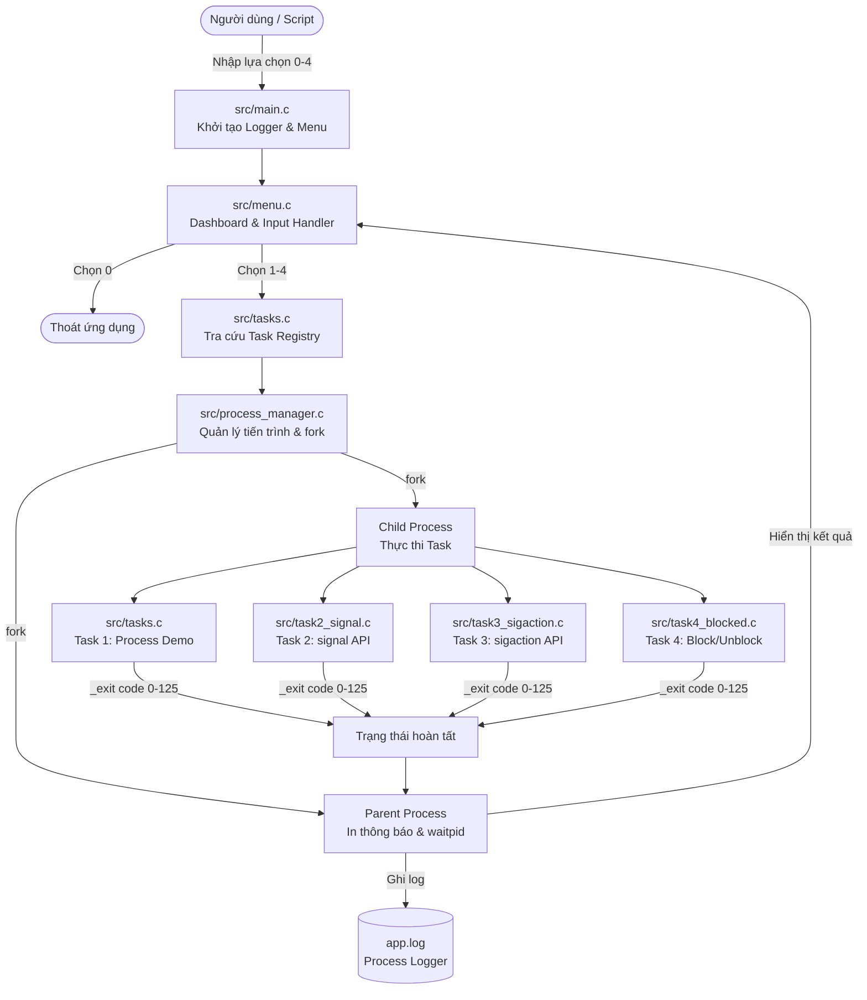

# SignalHandlerDemo: Implement and Demo for Signals Handler in C

> **Đề tài:** Implement and Demo for Signals Handler: `signal` and `sigaction` (blocked and unblocked signals) in C
> **Môn học:** Lập trình hệ thống (Systems Programming) — Trường Đại học Công nghệ Thông tin & Truyền thông Việt - Hàn (VKU)
> **Nền tảng:** Linux / POSIX.1-2008 / C11
> **Trạng thái:** 4/4 Tasks Implemented & Verified (Nhánh `full-project`)

---

## 1. Giới thiệu Đề tài

Trong hệ điều hành chuẩn POSIX (như Linux, Unix), **Signal** (tín hiệu) là cơ chế thông báo bất đồng bộ cấp nhân (kernel-level asynchronous notification) được sử dụng để thông báo cho một tiến trình biết một sự kiện quan trọng vừa xảy ra (ví dụ: lỗi phần cứng, tín hiệu điều khiển tiến trình, hết hạn timer, hoặc giao tiếp giữa các tiến trình IPC).

Dự án **SignalHandlerDemo** được xây dựng nhằm cung cấp một bộ công cụ thực nghiệm và minh họa trực quan, chuẩn xác về cơ chế xử lý tín hiệu trong ngôn ngữ C. Dự án giúp sinh viên và lập trình viên hệ thống nắm vững từ các khái niệm cơ bản với `signal()` đến các kỹ thuật xử lý nâng cao với `sigaction()`, thao tác với tập tín hiệu (`sigset_t`), kiểm soát tập hợp các tín hiệu đang bị chặn hoặc pending (`sigprocmask`, `sigpending`), và hiện tượng gộp tín hiệu (signal coalescing).

---

## 2. Mục tiêu Dự án

1. **Nắm vững vòng đời tiến trình & Mô hình Parent - Child**: Sử dụng `fork()`, `waitpid()`, `_exit()` để cô lập từng tác vụ demo vào tiến trình con độc lập, bảo vệ tiến trình menu cha không bị sự cố làm sập chương trình.
2. **Làm chủ API xử lý tín hiệu cơ bản (`signal`)**: Đăng ký handler tùy biến cho `SIGINT` và `SIGTSTP`, thực hiện giao tiếp IPC giữa 2 tiến trình bằng tín hiệu tự định nghĩa (`SIGUSR1`, `SIGUSR2`), và điều khiển bỏ qua tín hiệu (`SIG_IGN`) hoặc thiết lập disposition về hành vi mặc định (`SIG_DFL`).
3. **Hiểu rõ API nâng cao (`sigaction`)**: Phân tích cấu trúc `struct sigaction`, sử dụng cờ `SA_SIGINFO` để đọc siêu dữ liệu từ `siginfo_t` (PID người gửi, UID, mã nguyên nhân `si_code`), và so sánh cơ chế tự động khởi động lại system call (`SA_RESTART`) đối kháng với lỗi ngắt `EINTR` khi thực hiện `read()` trên pipe trên Linux.
4. **Kiểm soát Signal Mask & Trạng thái tín hiệu**: Khởi tạo và thao tác với `sigset_t`, chủ động chặn (`SIG_BLOCK`) và giải phóng (`SIG_UNBLOCK`) tín hiệu, kiểm tra tập hợp các tín hiệu đang pending (`sigpending`), và giải thích hiện tượng gộp tín hiệu (Signal Coalescing) của Standard Signals theo chuẩn POSIX và cách triển khai trên Linux.
5. **Đảm bảo tính an toàn trong lập trình hệ thống (Async-Signal-Safety)**: Tuân thủ quy tắc chỉ sử dụng các hàm tái nhập (reentrant) hoặc cờ `volatile sig_atomic_t` bên trong signal handlers.
6. **Xây dựng Terminal UI hiện đại (Modern Terminal UI)**: Trực quan hóa kết quả thực nghiệm với bảng mã màu ANSI, nhận biết TTY tự động, tương thích chuẩn `NO_COLOR`, và đồng bộ ghi nhật ký giữa các tiến trình phối hợp vào tệp `app.log`.

---

## 3. Danh sách Chức năng Chi tiết (Tasks 1 – 4)

Dự án hoàn thành trọn vẹn 4 nhiệm vụ kỹ thuật:

```
+------------------------------------------------------------------------+
| [1] TASK 1: ARCHITECTURE & PROCESS MANAGEMENT              [COMPLETED] |
|     * fork() & waitpid() parent-child process lifecycle management     |
|     * Process group terminal safety & concurrent logger (app.log)      |
+------------------------------------------------------------------------+
| [2] TASK 2: BASIC SIGNAL HANDLING                          [COMPLETED] |
|     * signal() custom handlers: SIGINT (Ctrl+C), SIGTSTP (Ctrl+Z)      |
|     * IPC kill() with SIGUSR1, SIGUSR2 and bidirectional pipe sync     |
|     * Signal ignoring (SIG_IGN) and default restoration (SIG_DFL)      |
+------------------------------------------------------------------------+
| [3] TASK 3: ADVANCED SIGNAL HANDLING                       [COMPLETED] |
|     * sigaction() struct with sa_mask and sa_flags                     |
|     * SA_SIGINFO 3-argument handler extracting siginfo_t context       |
|     * Syscall restart comparison: EINTR interruption vs SA_RESTART     |
+------------------------------------------------------------------------+
| [4] TASK 4: BLOCKED & UNBLOCKED SIGNALS                    [COMPLETED] |
|     * sigset_t signal sets: sigemptyset(), sigaddset(), sigismember()  |
|     * sigprocmask(SIG_BLOCK/UNBLOCK) and pending inspection            |
|     * Signal coalescing demonstration & safe state/disposition restore |
+------------------------------------------------------------------------+
```

### Task 1: Architecture & Process Management (Kiến trúc & Quản lý tiến trình)
- **Mô hình cô lập Parent - Child**: Khi người dùng chọn một tác vụ từ menu, tiến trình cha (`Parent`) sử dụng `fork()` để tạo một tiến trình con (`Child`). Tác vụ demo được thực thi trọn vẹn trong `Child`.
- **Đồng bộ hóa khởi động qua Pipe**: Sử dụng một đường ống ẩn (`start_pipe`) đảm bảo tiến trình cha luôn in thông báo tạo tiến trình trước khi tiến trình con bắt đầu xuất dữ liệu, loại bỏ hiện tượng tranh chấp thứ tự hiển thị khi chạy qua đường ống (pipeline mode).
- **Thu gom và xử lý mã thoát**: Tiến trình cha gọi `waitpid()` chờ con hoàn tất, đọc trạng thái kết thúc (`WIFEXITED`, `WEXITSTATUS`, `WIFSIGNALED`, `WTERMSIG`), thu dọn tài nguyên và tránh để lại tiến trình thây ma (Zombie Process) khi `waitpid()` hoạt động thành công. *(Lưu ý: `waitpid()` không ngăn chặn tiến trình con trở thành mồ côi nếu tiến trình cha bị lỗi hoặc kết thúc trước tiến trình con).*
- **Bộ ghi log đồng bộ giữa các tiến trình (`logger.c`)**: Tự động mở và ghi log vào `app.log` với timestamp `[YYYY-MM-DD HH:MM:SS]`, cấp độ log (`INFO`, `ERROR`), PID của tiến trình thực thi, và cơ chế khóa tệp advisory (`fcntl` POSIX record lock) để đồng bộ ghi log giữa các tiến trình phối hợp (không tự nhận thread-safe).

### Task 2: Basic Signal Handling using `signal()` (Xử lý tín hiệu cơ bản)
- **Phần 1 - Xử lý tín hiệu `SIGINT` và `SIGTSTP`**:
  - *Lý thuyết:* Phím tắt terminal (`Ctrl+C`, `Ctrl+Z`) do terminal driver phát sinh và chuyển thành tín hiệu gửi tới toàn bộ nhóm tiến trình tiền cảnh (foreground process group).
  - *Thực nghiệm thực tế trong mã nguồn:* Để bảo vệ tiến trình menu cha không bị ngắt hoặc tạm dừng bất ngờ và đáp ứng kiểm thử tự động, tiến trình con đăng ký custom handler cho `SIGINT` và `SIGTSTP`. Tiến trình cha sau đó sử dụng lời gọi hàm `kill(child_pid, SIGINT)` và `kill(child_pid, SIGTSTP)` gửi có chủ đích vào đúng tiến trình con để kiểm chứng việc handler kích hoạt và cập nhật biến cờ an toàn `volatile sig_atomic_t`.
- **Phần 2 - IPC Ping-Pong giữa 2 tiến trình con**:
  - Tạo 2 tiến trình con độc lập: *Worker 1* (nhận Ping, gửi Ack) và *Worker 2* (gửi Ping, nhận Ack).
  - Sử dụng đường ống 2 chiều để trao đổi PID an toàn, loại trừ điều kiện tranh race condition.
  - *Worker 2* gửi `SIGUSR1` ("Ping") sang *Worker 1* bằng `kill()`. *Worker 1* nhận tín hiệu, xác nhận và gửi đáp trả `SIGUSR2` ("Ack") về lại *Worker 2*.
- **Phần 3 - Phớt lờ (`SIG_IGN`) và Thiết lập mặc định (`SIG_DFL`)**:
  - Đăng ký `signal(SIGUSR1, SIG_IGN)`: Gửi `SIGUSR1` tới chính mình; chứng minh kernel loại bỏ tín hiệu, handler không chạy và tiến trình tiếp tục bình thường.
  - Đặt `signal(SIGUSR1, SIG_DFL)`: Thiết lập disposition về hành vi mặc định của tín hiệu (default disposition do hệ điều hành quy định).
- **Phần 4 - Phân tích hạn chế của hàm `signal()`**:
  - Trình bày các điểm yếu lịch sử của `signal()`: tính không di động giữa BSD và System V (hành vi tự động reset disposition về `SIG_DFL` sau mỗi lần ngắt), nguy cơ race condition nếu tín hiệu đến liên tiếp, không cấu hình được mặt nạ chặn tín hiệu lồng nhau (`sa_mask`), và không truyền được ngữ cảnh bổ sung.

### Task 3: Advanced Signal Handling using `sigaction()` (Xử lý tín hiệu nâng cao)
- **Phần 1 - Cấu trúc `struct sigaction`**: Minh họa cách khai báo cấu trúc, thiết lập mặt nạ tín hiệu `sa_mask` (sử dụng `sigemptyset`, `sigaddset`), và gán các cờ cấu hình `sa_flags`.
- **Phần 2 - Xử lý nâng cao với cờ `SA_SIGINFO`**:
  - Sử dụng prototype handler 3 đối số: `void handler(int signo, siginfo_t *info, void *context)`.
  - Trích xuất và kiểm chứng cấu trúc `siginfo_t`:
    - `si_signo`: Số hiệu tín hiệu nhận được.
    - `si_code`: Nguồn phát tín hiệu (ví dụ: `SI_USER` khi được gửi qua `kill()`).
    - `si_pid`: PID chính xác của tiến trình gửi tín hiệu.
    - `si_uid`: UID (User ID) của tiến trình gửi.
- **Phần 3 - Thực nghiệm cơ chế khởi động lại System Call (`SA_RESTART` vs `EINTR`)**:
  - *Lưu ý về phạm vi trên Linux:* Chuẩn POSIX không quy định một danh sách cố định chung cho mọi hệ điều hành về các system call được khởi động lại. Cụ thể trên hệ điều hành **Linux**:
    - Các lời gọi `read()` trên pipe, thiết bị I/O chậm (chẳng hạn terminal, socket) và `waitpid()` có thể được tự động khởi động lại khi cờ `SA_RESTART` được bật.
    - Ngược lại, các lời gọi dồn kênh I/O như `poll()`, `ppoll()`, `select()`, `pselect()` không bao giờ được tự động khởi động lại bởi `SA_RESTART` mà luôn thất bại với mã lỗi `EINTR` nếu bị ngắt bởi tín hiệu có handler.
  - *Thực nghiệm trên pipe trong dự án:*
    - **Trường hợp 1 (Không có `SA_RESTART`)**: Khi tín hiệu được gửi đến trong lúc tiến trình con đang chặn ở `read(pipe_fd, ...)`, lời gọi `read()` lập tức bị ngắt, trả về giá trị `-1` và biến lỗi hệ thống `errno` nhận chính xác giá trị `EINTR` (Interrupted system call). *(Lưu ý: Nếu một phần dữ liệu đã được chuyển giao vào bộ đệm trước khi tín hiệu ngắt xảy ra, `read()` sẽ trả về số byte thực tế đã đọc được thay vì trả về -1 kèm lỗi `EINTR`).*
    - **Trường hợp 2 (Có cờ `SA_RESTART`)**: Với `read()` trên pipe, Linux kernel tự động tiếp tục (restart) lại system call sau khi handler chạy xong; khi tiến trình cha ghi dữ liệu vào pipe, `read()` nhận dữ liệu thành công mà không bị ngắt hay trả về `EINTR`.
    - Cơ chế đồng bộ có giới hạn thời gian (Timeout 3.0s sử dụng `poll()` và monotonic clock) đảm bảo an toàn, không để chương trình bị treo vô hạn nếu xảy ra sự cố.
- **Phần 4 - So sánh `signal()` và `sigaction()`**: Bảng đối chiếu được căn chỉnh trong khung rộng 74 ký tự, tóm lược rành mạch các khác biệt kỹ thuật.

### Task 4: Blocked and Unblocked Signals (Quản lý mặt nạ & Trạng thái tín hiệu)
- **Phần 1 - Blocked, Pending & Signal Coalescing**:
  - Đăng ký handler cho `SIGUSR1` bằng `sigaction`.
  - Tạo tập tín hiệu (`sigset_t`), thêm `SIGUSR1` vào tập bằng `sigaddset()`.
  - Chặn tín hiệu bằng `sigprocmask(SIG_BLOCK, &set, &oldset)`.
  - Gửi liên tiếp `SIGUSR1` 3 lần vào chính tiến trình bằng `kill(getpid(), SIGUSR1)`.
  - Dùng `sigpending()` để lấy tập hợp các tín hiệu đang pending vào cấu trúc `sigset_t`, sau đó dùng `sigismember()` xác nhận `SIGUSR1` đang ở trạng thái **PENDING** trong kernel và handler chưa hề được thực thi.
  - Bỏ chặn bằng `sigprocmask(SIG_UNBLOCK, &set, NULL)`: Tín hiệu pending lập tức được giải phóng và handler thực thi.
  - **Minh họa hiện tượng gộp tín hiệu (Signal Coalescing):**
    - Mặc dù gửi 3 lần, handler chỉ chạy đúng **1 lần** duy nhất.
    - *Theo chuẩn POSIX:* Hệ điều hành không bắt buộc phải xếp hàng (queue) các tín hiệu tiêu chuẩn (standard signals) nếu cùng một loại tín hiệu phát sinh nhiều lần trong khi tín hiệu đó đang ở trạng thái pending.
    - *Triển khai trên Linux:* Linux kernel quản lý các pending standard signals bằng một bitmap nội bộ (mỗi tín hiệu tiêu chuẩn chỉ tương ứng với 1 bit cờ). Đây là chi tiết cài đặt của Linux, không phải yêu cầu bắt buộc về cấu trúc nội bộ của mọi hệ điều hành POSIX.
    - *Phân biệt với Real-Time Signals (POSIX.1b, từ `SIGRTMIN` đến `SIGRTMAX`):* Các tín hiệu thời gian thực hỗ trợ cơ chế hàng đợi riêng biệt (signal queuing) cho từng lần gửi và có thể truyền kèm dữ liệu thông qua `sigqueue()`.
- **Phần 2 - Khôi phục toàn vẹn trạng thái hệ thống**: Sử dụng `sigprocmask(SIG_SETMASK, &orig_mask, NULL)` để khôi phục chính xác mặt nạ tín hiệu ban đầu, cùng việc hoàn trả disposition của các tín hiệu về trạng thái gốc trước khi kết thúc tác vụ.
- **Phần 3 - Bảng đối chiếu 4 trạng thái tín hiệu**: Phân biệt rành mạch giữa **Blocked**, **Pending**, **Ignored**, và **Handled**.

---

## 4. Kiến trúc Hệ thống & Cấu trúc Thư mục

### 4.1. Sơ đồ Kiến trúc Điều hướng & Vòng đời Tiến trình



### 4.2. Cấu trúc Cây Thư mục Thực tế

Dưới đây là cấu trúc tệp tin thực tế có trong kho mã nguồn:

```
SignalHandlerDemo/
├── Makefile                # Kịch bản biên dịch GNU Make với cờ kiểm tra nghiêm ngặt
├── README.md               # Tài liệu hướng dẫn kỹ thuật toàn diện
├── app.log                 # Nhật ký thực thi của ứng dụng (tự động sinh khi chạy)
├── .gitignore              # Danh sách loại trừ các file binary và build
├── include/                # Thư mục chứa các tệp tiêu đề (Header files)
│   ├── logger.h            # Giao diện bộ ghi nhật ký đồng bộ giữa các tiến trình
│   ├── menu.h              # Giao diện điều hướng menu chính
│   ├── process_manager.h   # Giao diện tạo và quản lý vòng đời tiến trình
│   ├── task_api.h          # Định nghĩa kiểu hàm callback cho các Task
│   ├── tasks.h             # Registry danh mục 4 Tasks
│   ├── task2_signal.h      # Khai báo hàm thực thi Task 2
│   ├── task3_sigaction.h   # Khai báo hàm thực thi Task 3
│   ├── task4_blocked.h     # Khai báo hàm thực thi Task 4
│   └── ui_theme.h          # Hệ thống giao diện Modern Terminal UI & mã màu ANSI
└── src/                    # Thư mục chứa mã nguồn triển khai (.c)
    ├── logger.c            # Triển khai ghi log giữa các tiến trình phối hợp với khóa fcntl
    ├── main.c              # Hàm main(): điểm vào khởi tạo và kết thúc ứng dụng
    ├── menu.c              # Xử lý vòng lặp menu tương tác và pipeline mode
    ├── process_manager.c   # Quản lý fork(), đồng bộ pipe, thu gom waitpid()
    ├── task2_signal.c      # Triển khai toàn bộ chức năng và thực nghiệm Task 2
    ├── task3_sigaction.c   # Triển khai cấu trúc sigaction, SA_SIGINFO, SA_RESTART
    ├── task4_blocked.c     # Triển khai sigprocmask, sigpending, coalescing
    ├── tasks.c             # Triển khai Task 1 và bảng tra cứu task registry
    └── ui_theme.c          # Quản lý màu ANSI, phát hiện TTY và chuẩn NO_COLOR
```

---

## 5. Công nghệ & Chuẩn Lập trình Sử dụng

- **Ngôn ngữ lập trình:** C11 (Chuẩn ISO/IEC 9899:2011).
- **Chuẩn hệ điều hành:** POSIX.1-2008 (được kích hoạt thông qua macro `-D_POSIX_C_SOURCE=200809L`).
- **Trình biên dịch:** GCC (hỗ trợ chuẩn C11) hoặc trình biên dịch C tương thích POSIX.
- **Công cụ tự động hóa bản dựng:** GNU Make.
- **Hệ điều hành mục tiêu:** Linux (Ubuntu 20.04 / 22.04 / 24.04 LTS, Debian, Fedora, Arch) hoặc môi trường Windows Subsystem for Linux (WSL / WSL2).
- **Giao diện người dùng:** Modern ANSI Terminal UI:
  - Bảng mã ANSI 16-color & Attributes (Bold, Dim, Reset).
  - Tự động nhận diện TTY (`isatty`) để bật/tắt định dạng màu thông minh.
  - Hỗ trợ tiêu chuẩn quốc tế **NO_COLOR** (https://no-color.org).

---

## 6. Tổng hợp Các System Call & API POSIX Quan trọng

Dự án ứng dụng đầy đủ các System Call then chốt của Linux/Unix:

| Nhóm chức năng | System Call / Thư viện C | Mục đích sử dụng trong dự án |
|---|---|---|
| **Quản lý tiến trình** | `fork()` | Tách tiến trình con để chạy từng Task độc lập |
| | `waitpid()` | Tiến trình cha chờ tiến trình con và đọc trạng thái thoát |
| | `_exit()` | Thoát tiến trình con ngay lập tức mà không xáo trộn stdio buffer |
| | `getpid()`, `getppid()` | Lấy ID của tiến trình hiện tại và tiến trình cha |
| **Xử lý tín hiệu cơ bản** | `signal()` | Đăng ký handler đơn giản, thiết lập `SIG_IGN` và `SIG_DFL` |
| | `kill()` | Gửi tín hiệu đến tiến trình chỉ định hoặc chính mình |
| **Xử lý tín hiệu nâng cao** | `sigaction()` | Thiết lập cấu trúc `sigaction`, đổi handler và cấu hình cờ |
| | `siginfo_t` | Cấu trúc dữ liệu chứa metadata (PID, UID, mã lỗi `si_code`) |
| **Quản lý tập tín hiệu** | `sigemptyset()` | Khởi tạo tập tín hiệu rỗng |
| | `sigaddset()`, `sigdelset()` | Thêm hoặc bớt một tín hiệu vào/khỏi tập `sigset_t` |
| | `sigismember()` | Kiểm tra một tín hiệu có thuộc tập `sigset_t` hay không |
| | `sigprocmask()` | Đọc hoặc thay đổi signal mask của tiến trình (`SIG_BLOCK`, `SIG_UNBLOCK`, `SIG_SETMASK`) |
| | `sigpending()` | Lấy tập hợp các tín hiệu đang pending (đang chờ xử lý) dưới dạng `sigset_t` |
| **Đồng bộ hóa & IPC** | `pipe()` | Tạo đường ống liên tiến trình để trao đổi dữ liệu |
| | `read()`, `write()`, `close()` | Nhập/xuất dữ liệu nhị phân qua file descriptor của pipe |
| | `poll()` | Chờ sự kiện có dữ liệu trên descriptor với thời gian timeout |
| | `clock_gettime()` | Đo thời gian đơn điệu (`CLOCK_MONOTONIC`) tính toán deadline chính xác |
| **Bộ ghi log & Tệp tin** | `fcntl()` | Đặt khóa ghi tệp advisory (`F_SETLK`/`F_SETLKW`) để đồng bộ ghi log giữa các tiến trình phối hợp vào `app.log` |

---

## 7. Hướng dẫn Cài đặt Môi trường

### 7.1. Cài đặt trên hệ điều hành Linux (Ubuntu / Debian)
Mở terminal và cài đặt các gói công cụ cần thiết:
```bash
sudo apt update
sudo apt install -y build-essential gcc make git
```

### 7.2. Cài đặt trên Windows qua WSL (Windows Subsystem for Linux)
Nếu bạn đang sử dụng hệ điều hành Windows 10 hoặc Windows 11:
1. Mở PowerShell với quyền Administrator và cài đặt Ubuntu WSL:
   ```powershell
   wsl --install -d Ubuntu
   ```
2. Khởi động lại máy (nếu được yêu cầu) và tạo tài khoản người dùng Ubuntu.
3. Mở terminal Ubuntu WSL và cài đặt công cụ biên dịch:
   ```bash
   sudo apt update && sudo apt install -y build-essential gcc make git
   ```

---

## 8. Hướng dẫn Biên dịch

Mã nguồn được cấu hình tự động thông qua `Makefile`. Trình biên dịch được thiết lập các cờ kiểm tra nghiêm ngặt nhất để đảm bảo chất lượng mã nguồn:
- `-std=c11`: Tuân thủ chuẩn ngôn ngữ C11.
- `-Wall -Wextra -Wpedantic`: Bật toàn bộ cảnh báo tiêu chuẩn và nâng cao.
- `-Werror`: Biến mọi cảnh báo thành lỗi biên dịch (không chấp nhận code bẩn).
- `-O2`: Tối ưu hóa hiệu năng thực thi.
- `-D_POSIX_C_SOURCE=200809L`: Kích hoạt đầy đủ các tính năng POSIX.1-2008.

### Lệnh biên dịch:
```bash
# Xóa bản dựng cũ và biên dịch lại từ đầu:
make clean && make
```

File thực thi sau khi biên dịch thành công sẽ nằm tại: `build/signal-handler-demo`.

---

## 9. Hướng dẫn Chạy Chương trình

### 9.1. Chạy trực tiếp từ Terminal
```bash
./build/signal-handler-demo
```
*(Nếu muốn biên dịch rồi chạy ngay, bạn có thể dùng `make run`)*

### 9.2. Chạy trên Windows từ Visual Studio Code
Nếu bạn mở thư mục dự án trên VS Code trên Windows:
1. Nhấn phím `Ctrl + Shift + B` để thực thi tác vụ **Build (WSL)** mặc định.
2. Mở menu **Terminal** $\rightarrow$ **Run Task** $\rightarrow$ chọn **Run Demo (WSL)** để chạy ứng dụng trực tiếp trong Terminal tích hợp của VS Code.

---

## 10. Hướng dẫn Sử dụng Menu Dashboard

Khi khởi chạy, chương trình hiển thị bảng điều khiển Modern Terminal UI:

```
==========================================================================
                  SIGNAL HANDLER DEMO (C POSIX)
    Implement and Demo for Signals Handler: signal & sigaction in C
--------------------------------------------------------------------------
  Platform: Linux / POSIX C                  Status: 4/4 TASKS IMPLEMENTED
  Menu Process PID: 6141                     Author: Systems Programming
==========================================================================
+------------------------------------------------------------------------+
| [1] TASK 1: ARCHITECTURE & PROCESS MANAGEMENT              [COMPLETED] |
|     * fork() & waitpid() parent-child process lifecycle management     |
|     * Process group terminal safety & concurrent logger (app.log)      |
+------------------------------------------------------------------------+
| [2] TASK 2: BASIC SIGNAL HANDLING                          [COMPLETED] |
|     * signal() custom handlers: SIGINT (Ctrl+C), SIGTSTP (Ctrl+Z)      |
|     * IPC kill() with SIGUSR1, SIGUSR2 and bidirectional pipe sync     |
|     * Signal ignoring (SIG_IGN) and default restoration (SIG_DFL)      |
+------------------------------------------------------------------------+
| [3] TASK 3: ADVANCED SIGNAL HANDLING                       [COMPLETED] |
|     * sigaction() struct with sa_mask and sa_flags                     |
|     * SA_SIGINFO 3-argument handler extracting siginfo_t context       |
|     * Syscall restart comparison: EINTR interruption vs SA_RESTART     |
+------------------------------------------------------------------------+
| [4] TASK 4: BLOCKED & UNBLOCKED SIGNALS                    [COMPLETED] |
|     * sigset_t signal sets: sigemptyset(), sigaddset(), sigismember()  |
|     * sigprocmask(SIG_BLOCK/UNBLOCK) and pending inspection            |
|     * Signal coalescing demonstration & safe state/disposition restore |
+------------------------------------------------------------------------+
| [0] EXIT / THOAT CHUONG TRINH                                          |
|     * Clean process termination & resource cleanup                     |
+------------------------------------------------------------------------+
==========================================================================
  Nhap lua chon [1-4] de chay nhiem vu, hoac [0] de thoat:
```

- Nhập `1`: Chạy thực nghiệm Task 1 (Quản lý tiến trình cha con & logger).
- Nhập `2`: Chạy thực nghiệm Task 2 (`signal`, `SIGINT`, `SIGTSTP`, IPC `SIGUSR1`/`SIGUSR2`, `SIG_IGN`, `SIG_DFL`).
- Nhập `3`: Chạy thực nghiệm Task 3 (`sigaction`, `SA_SIGINFO`, `EINTR` vs `SA_RESTART` trên pipe).
- Nhập `4`: Chạy thực nghiệm Task 4 (`sigprocmask`, block, pending, coalescing).
- Nhập `0`: Thoát ứng dụng, dọn dẹp tài nguyên và đóng logger.

---

## 11. Hướng dẫn Kiểm thử Từng Task (Automated Pipeline Mode)

Bạn có thể kiểm thử tự động từng Task mà không cần nhập tay thông qua cơ chế đường ống (pipeline):

### Kiểm tra Task 1:
```bash
printf "1\n0\n" | ./build/signal-handler-demo
```
*Kỳ vọng:* Tiến trình cha tạo con, con in PID/PPID, cha thu gom trạng thái `exit=0`.

### Kiểm tra Task 2:
```bash
printf "2\n0\n" | ./build/signal-handler-demo
```
*Kỳ vọng:* Đăng ký handler và kiểm thử an toàn qua `kill()` với `SIGINT`, `SIGTSTP`; IPC Ping-Pong hai chiều `SIGUSR1`/`SIGUSR2` giữa 2 tiến trình con thành công; minh họa `SIG_IGN` và thiết lập `SIG_DFL` thành công.

### Kiểm tra Task 3:
```bash
printf "3\n0\n" | ./build/signal-handler-demo
```
*Kỳ vọng:* Trích xuất metadata `siginfo_t` chính xác; chứng minh trường hợp không có `SA_RESTART` khi `read()` trên pipe bị ngắt với `EINTR`; trường hợp có `SA_RESTART` tự động tiếp tục đọc dữ liệu thành công; bảng đối chiếu được căn chỉnh trong khung rộng 74 ký tự ngay ngắn.

### Kiểm tra Task 4:
```bash
printf "4\n0\n" | ./build/signal-handler-demo
```
*Kỳ vọng:* Chặn `SIGUSR1`, gửi 3 lần, dùng `sigpending()` xác nhận `is_member=1` trong tập tín hiệu pending, sau khi `sigprocmask(SIG_UNBLOCK)` handler chỉ chạy đúng 1 lần (Coalescing thành công); khôi phục an toàn mask ban đầu.

---

## 12. Hướng dẫn Kiểm thử Toàn bộ (Full Regression Test)

Để kiểm tra tính toàn vẹn của toàn bộ dự án từ Task 1 đến Task 4 liên tục trong một lần chạy:

```bash
printf "1\n2\n3\n4\n0\n" | ./build/signal-handler-demo
```

**Kết quả kỳ vọng:**
- Lần lượt cả 4 Task chạy tuần tự không bị xung đột tín hiệu, không bị treo (deadlock), không phát sinh lỗi bộ nhớ.
- Mã trả về cuối cùng của chương trình là `0` (`echo $?` in ra `0`).
- Toàn bộ tiến trình con được giải phóng sạch sẽ khi `waitpid()` hoàn tất (không tồn tại tiến trình zombie).

---

## 13. Hỗ trợ Chuẩn NO_COLOR & Tự động Nhận diện TTY

Dự án tuân thủ chuẩn quốc tế về màu sắc terminal:
1. **Tự động nhận diện chuyển hướng (Pipe / Redirect):**
   Nếu đầu ra `stdout` bị chuyển hướng vào file hoặc pipe (ví dụ: `./build/signal-handler-demo > output.txt`), chương trình tự động tắt toàn bộ mã màu ANSI để file văn bản thuần túy không bị dính ký tự rác.
2. **Kích hoạt chế độ `NO_COLOR`:**
   Nếu bạn thiết lập biến môi trường `NO_COLOR=1`, chương trình sẽ chạy ở chế độ đơn sắc (Monochrome) nhưng vẫn giữ nguyên cấu trúc viền bảng trực quan:
   ```bash
   NO_COLOR=1 ./build/signal-handler-demo
   ```

---

## 14. Các Giới hạn Kỹ thuật Cần Lưu Ý

1. **Nguyên tắc Async-Signal-Safety (An toàn trong Signal Handler):**
   - Tiêu chuẩn POSIX quy định nghiêm ngặt về các hàm được phép gọi bên trong một Signal Handler.
   - Các hàm như `printf()`, `malloc()`, `free()`, `exit()`, hoặc hàm ghi log có sử dụng lock mutex/file **KHÔNG** an toàn (non-reentrant). Nếu tín hiệu xảy ra khi chương trình chính đang nắm giữ heap lock hoặc I/O buffer lock, việc gọi lại các hàm này trong handler sẽ gây ra hiện tượng **Deadlock** hoặc phá hủy dữ liệu bộ nhớ.
   - Trong dự án này, toàn bộ handler được thiết kế chuẩn mực: chỉ thay đổi cờ kiểu `volatile sig_atomic_t` hoặc dùng syscall an toàn như `write()`.
2. **Hành vi khởi động lại của `SA_RESTART` trên Linux:**
   - Cần lưu ý rằng việc khởi động lại system call không phải là một quy tắc chung áp dụng đồng nhất cho mọi hệ điều hành POSIX, mà phụ thuộc vào việc hiện thực của từng kernel.
   - Cụ thể trên **Linux**:
     - Cờ `SA_RESTART` có thể tự động khởi động lại một số system call nhất định, tiêu biểu là `read()` trên pipe hoặc thiết bị I/O chậm (như terminal, socket) và `waitpid()`.
     - Các system call dồn kênh I/O như `poll()`, `ppoll()`, `select()`, `pselect()` **không** bao giờ được tự động khởi động lại bởi `SA_RESTART` mà luôn trả về `-1` với `errno == EINTR` khi bị ngắt bởi tín hiệu có handler.
     - Đối với lời gọi `read()`, nếu dữ liệu đã được chuyển giao một phần vào bộ đệm trước thời điểm tín hiệu ngắt phát sinh, `read()` sẽ trả về số byte thực tế đã đọc được chứ không trả về `-1` kèm `EINTR`, và cũng không thực hiện khởi động lại system call.
3. **Bản chất của `sigpending()` và hiện tượng gộp tín hiệu (Signal Coalescing):**
   - Hàm `sigpending()` trả về **tập hợp các tín hiệu đang pending** (đang chờ xử lý) dưới dạng cấu trúc tập tín hiệu `sigset_t`, hoàn toàn không phải một hàng đợi lưu vết từng lần gửi tín hiệu riêng lẻ.
   - Theo chuẩn POSIX, hệ điều hành không bắt buộc phải xếp hàng các tín hiệu tiêu chuẩn (Standard Signals) nếu cùng một loại tín hiệu phát sinh nhiều lần trong khi tín hiệu đó đang bị chặn (blocked).
   - Trên Linux, kernel quản lý trạng thái pending của standard signals bằng một bitmap nội bộ (1 bit cho mỗi tín hiệu). Do đó, khi unblock, handler chỉ được gọi duy nhất 1 lần bất kể số lần gửi trước đó. Để truyền dữ liệu và bảo toàn từng tín hiệu riêng biệt có xếp hàng, cần sử dụng Real-Time Signals (`SIGRTMIN` đến `SIGRTMAX`) kết hợp với `sigqueue()`.
4. **Cơ chế khóa tệp của Logger:**
   - Khóa `fcntl` (`F_SETLK`/`F_SETLKW`) được sử dụng trong `logger.c` là cơ chế advisory record lock giữa các tiến trình độc lập trong hệ điều hành. Cơ chế này không đồng bộ an toàn giữa các luồng (threads) trong cùng một tiến trình vì tất cả các luồng cùng chia sẻ chung bảng mô tả tệp.
5. **Vòng đời tiến trình & Thu gom Zombie:**
   - Lời gọi `waitpid()` trong tiến trình cha chỉ thu gom và ngăn chặn tiến trình con trở thành zombie khi tiến trình cha còn sống và thực hiện `waitpid()` thành công. Nếu tiến trình cha bị kết thúc bất thường trước khi kịp gọi `waitpid()`, tiến trình con sẽ trở thành tiến trình mồ côi (orphan) và được kernel chuyển quyền nuôi dưỡng cho tiến trình `init` (PID 1 hoặc systemd).
6. **Bộ đệm đầu ra (Stdio Buffering):**
   - Khi chạy ở chế độ tương tác (TTY), `stdout` là line-buffered (xả đệm khi gặp ký tự xuống dòng `\n`). Nhưng khi chạy qua pipe, `stdout` chuyển thành block-buffered (thường đầy 4KB mới xả). Dự án đã xử lý vấn đề này bằng việc gọi `fflush(stdout)` tại các điểm đồng bộ then chốt.

---

## 15. Thông tin Git & Cách Lấy Mã Nguồn

- **Repository URL:** `https://github.com/nguyenleanhkkiet/SignalHandlerDemo.git`
- **Nhánh hoàn thiện đầy đủ:** `full-project`

### Các bước clone và chạy dự án:

```bash
# 1. Clone repository về máy:
git clone https://github.com/nguyenleanhkkiet/SignalHandlerDemo.git

# 2. Di chuyển vào thư mục dự án:
cd SignalHandlerDemo

# 3. Chuyển sang nhánh hoàn thiện (full-project):
git checkout full-project

# 4. Biên dịch mã nguồn:
make clean && make

# 5. Khởi chạy ứng dụng:
./build/signal-handler-demo
```

---
*Tài liệu được hoàn thiện và chuẩn hóa cho đồ án Lập trình Hệ thống (VKU).*
